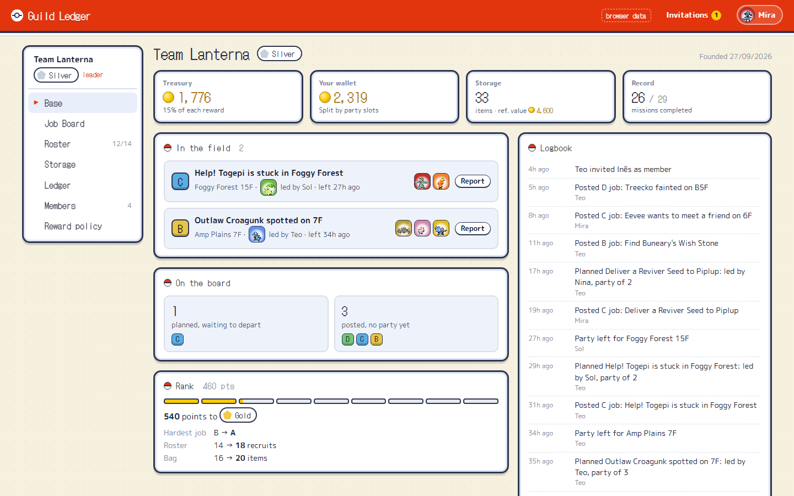
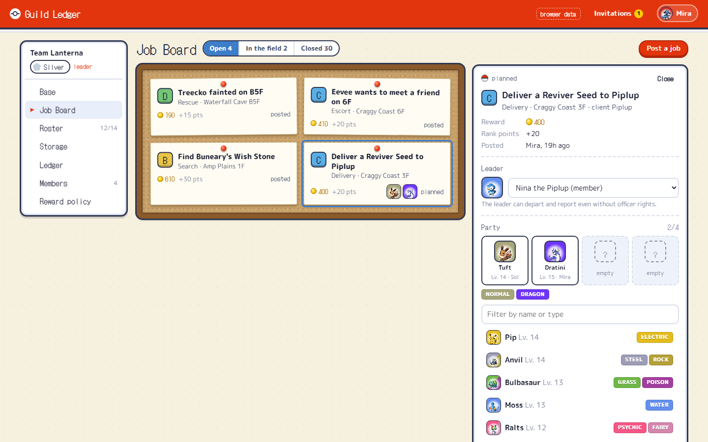
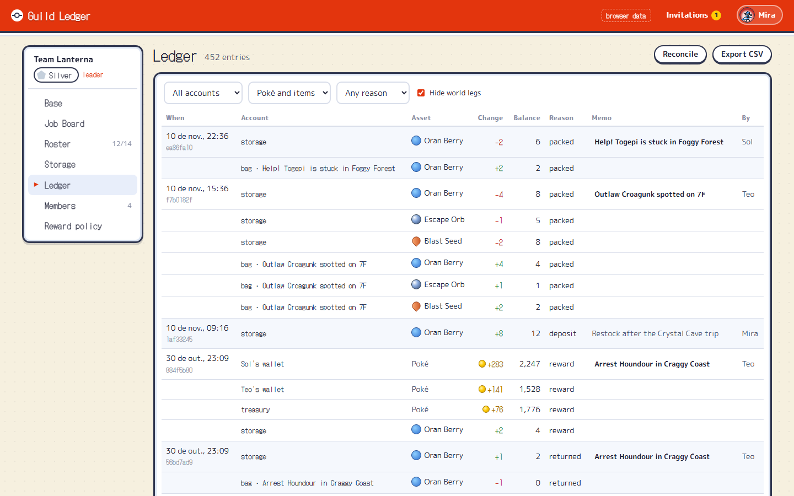
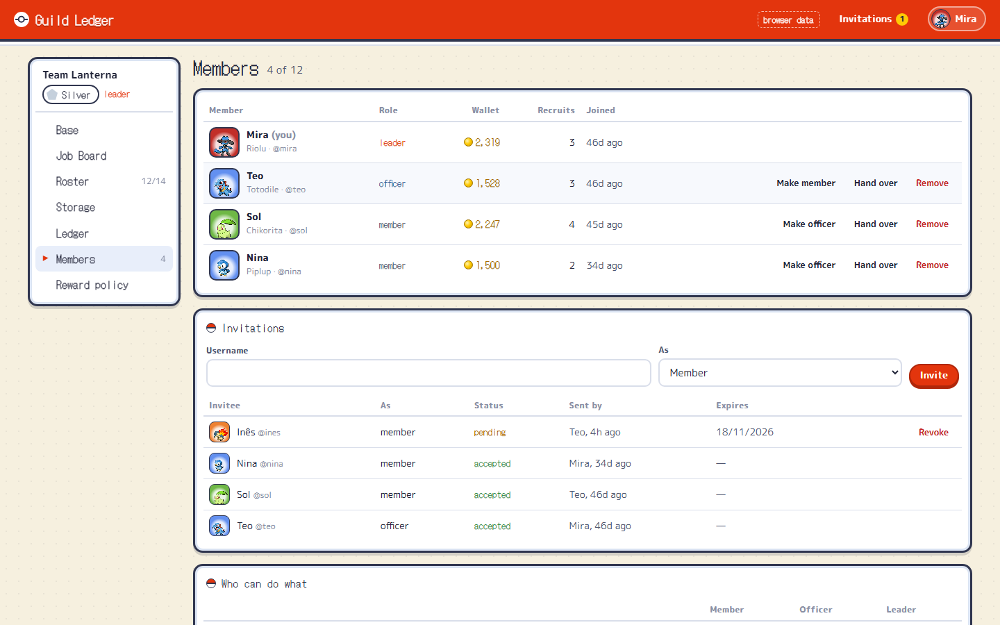
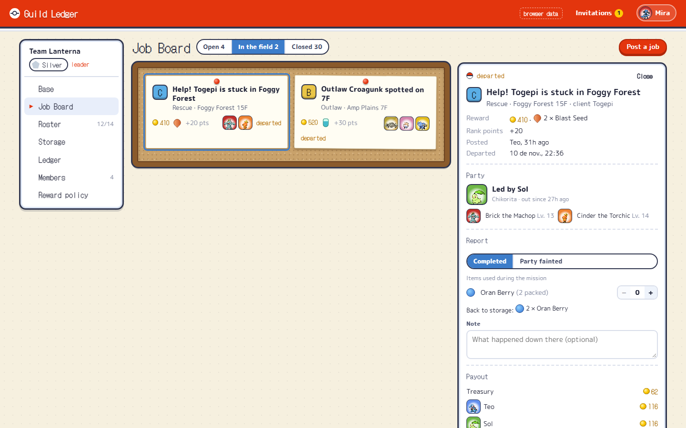

# Guild Ledger

A manager for a Mystery Dungeon–style exploration team: the roster of recruited Pokémon, the job board, the shared storage and treasury, and a ledger that accounts for every Poké and item the team moves. As in the games, the explorers are Pokémon too: every account picks a species when it registers.

Spring Boot API (Java 21, Spring Security with JWT, JPA/Hibernate, Flyway, PostgreSQL) and a React client. The GitHub Pages build runs without a server: it swaps HTTP for an in-browser port of the API that passes the same contract scenario.

[Open the browser build](https://arthurgaspar.github.io/pokemon-md-guild-ledger/) · [API endpoints](#api) · [Rules](#rules)



## Using it

The browser build starts with **Team Lanterna**: 46 days of history, 12 recruits, two parties out, one ready to depart and three jobs posted. Every seeded account uses the password `lantern-123`. Sign in as different people to see what each role can do; the account menu switches between them.

| Account | Pokémon | Role |
|---|---|---|
| `mira` | Riolu | Leader of Team Lanterna; has an invitation from Team Driftwood |
| `teo` | Totodile | Officer |
| `sol` | Chikorita | Member |
| `nina` | Piplup | Member |
| `kai` | Chimchar | Leader of Team Driftwood |
| `ines` | Cyndaquil | No team; has an invitation from Team Lanterna |

**Base** shows parties in the field, jobs waiting for a party, rank progress with what the next rank unlocks, and the logbook.

**Job Board** is a cork board of pinned job notices. Officers post a job (dungeon, floor, difficulty, client, reward), then plan it: pick a leader, up to four available recruits, and a bag packed from storage. The panel shows the payout split for that plan before anything is saved. Departing moves the bag out of storage. Reporting a success records which items were used, returns the rest, pays the reward and gives exp to the party. Reporting a failure loses the bag.



**Roster**: recruit by species and level, rename, release, and filter by status, type or recruiter. Capacity depends on team rank.

**Storage**: item stock, mission bags currently out, treasury and wallets. Members store items and give wallet Poké to the treasury. Officers discard items and record outside income. The leader pays members.

**Ledger**: every movement, grouped by transaction. Filter by account, asset, reason or mission, export CSV, or **Reconcile**, which replays the whole ledger against the cached balances.



**Members**: each member's Pokémon, role, wallet and recruits; invitations (sent, accepted, expired, revoked); and a table of who can do what. **Reward policy**: the treasury cut and split mode, with a calculator that shows a draft policy next to the saved one.



Registering means choosing your Pokémon from the Mystery Dungeon starters, or any species in the catalog. You can change it later from the account menu. The member's Pokémon appears wherever that person does: mission leaders, payout shares, wallets, recruiters.



## Rules

### Roles

| | Member | Officer | Leader |
|---|:-:|:-:|:-:|
| Recruit, store items, give Poké to the treasury, cash out own wallet | ● | ● | ● |
| Depart and report a mission they lead | ● | ● | ● |
| Rename or release own recruits | ● | ● (any) | ● (any) |
| Post, plan, depart, report and take down any job | | ● | ● |
| Invite members, remove members | | ● | ● |
| Discard items, record outside income | | ● | ● |
| Invite officers, change roles, hand over leadership, remove officers | | | ● |
| Pay members from the treasury, set the reward policy | | | ● |

People outside a team get `404` for its resources, not `403`, so team ids can't be probed. The leader can't leave without handing over the team first. A member who leads a planned or departed mission can't be removed until it is reassigned or closed.

### Invitations

Officers invite by username. Each person can have one pending invitation per team. Invitations expire after 7 days; expiry is evaluated on read, so no scheduler is needed. Team size (12) is checked when the invitation is sent and again when it is accepted.

### Missions

`POSTED → PLANNED → DEPARTED → COMPLETED | FAILED`, and `POSTED | PLANNED → CANCELLED`.

- Rank caps the hardest job a team can post: Normal up to D, Bronze C, Silver B, Gold A, Diamond and Super S, Ultra and above ★.
- A party is 1–4 different recruits. They must be home and not planned for another job.
- Bag capacity depends on rank. Stock is checked when planning and enforced at departure.
- On success, each recruit gains the difficulty's exp (Medium Fast curve: level *n* needs *n*³ exp), and the team gains rank points.

### Reward split

1. The treasury takes `floor(reward × cut%)`.
2. The rest goes to the participants: the mission leader and every member who recruited someone in the party. **Equal** gives each participant one share. **By party slots** gives one share per recruit sent, plus one for leading.
3. Shares are rounded down, and the remainder goes to the treasury, so the parts always add up to the reward. Members who have left don't participate.

### Ledger

Accounts: `treasury`, `storage`, `wallet:<member>`, `bag:<mission>` and `world`. Every transaction is a set of legs that nets to zero per asset (Poké or an item). `world` is the counterpart for anything entering or leaving the team: rewards, outside deposits, items used or lost, cash-outs. It is the only account allowed to go negative.

Entries are append-only, and each records the balance after it. Balances are cached in a separate table for reads. `GET /ledger/reconcile` checks that every transaction nets to zero, every recorded running balance follows from the previous one, no account other than `world` is negative, and replayed totals equal the cached balances. Ledger writes lock the team row, so concurrent withdrawals are serialized; `ConcurrentPayoutTest` races eight payouts against a treasury that can cover three.

Leaving the team cashes the wallet out (`CASH_OUT`), so departed members never hold a balance.

## Running

### Browser build (no server)

```bash
cd web
npm ci
npm run dev        # http://localhost:5173, data kept in this browser's localStorage
```

**Reset browser data** in the account menu reseeds the demo.

### API with the client

Java 21 and Node 22. The `local` profile uses an H2 file database in PostgreSQL mode, so no database install is needed:

```bash
cd api
./mvnw spring-boot:run -Dspring-boot.run.profiles=local     # http://localhost:8080

cd web
npm run dev:api                                             # client pointed at :8080 (see web/.env.api)
```

Against PostgreSQL, set `GUILD_DB_URL`, `GUILD_DB_USER` and `GUILD_DB_PASSWORD` and run without the profile. Set `GUILD_JWT_SECRET` (32+ bytes) anywhere shared. `GUILD_CORS_ORIGINS` lists the allowed web origins. Swagger UI is at `/swagger-ui.html`.

### Docker

```bash
docker compose up --build    # web :5173, API :8080, PostgreSQL in a volume
```

## Tests

```bash
cd api && ./mvnw verify      # JUnit: contract scenario, payout, leveling, security, concurrency
cd web && npm test           # Vitest: the same contract scenario, payout, demo seed
```

`shared/contract/scenario.json` is a 76-step story: registering as a Pokémon, changing species, founding a team, invitations, permission failures, recruiting, stocking storage, rank-locked jobs, an over-capacity bag, a successful rescue with exact payouts and level-ups, a failed mission that loses its bag, treasury movements, a member leaving and a leadership handover, ending with a reconciled ledger. It runs against:

- the Spring API on H2 (`ContractScenarioTest`),
- the Spring API on PostgreSQL 17 via Testcontainers (`PostgresContractTest`; skipped when Docker isn't available, runs in CI),
- the in-browser engine (`contract.test.ts`).

Each step checks status codes, error codes and response values, so a rule changed on one side and not the other fails a build.

Other tests: payout invariants over 5,000 random splits (no Poké created or lost) in Java and TypeScript, level thresholds, expired and forged tokens, invitation expiry with a controllable clock, the concurrent payout race, and a check that the demo history builds through the engine's routes and reconciles.

## API

All routes are under `/api`. Everything except register, login and the catalog needs `Authorization: Bearer <token>`. Errors are RFC 7807 problem details with a stable `code` (`bag.over-capacity`, `ledger.insufficient-funds`, `mission.difficulty-locked`, …).

| | |
|---|---|
| `POST /auth/register`, `POST /auth/login`, `GET /me`, `PATCH /me` | Accounts, tokens (HS256 JWT, 12 h), display name and species |
| `GET /catalog` | Species, items, dungeons, ranks, difficulties |
| `GET/POST /teams`, `GET /teams/{id}`, `PUT /teams/{id}/policy` | Teams and reward policy |
| `GET /teams/{id}/members`, `PATCH`/`DELETE …/members/{m}`, `POST …/leadership` | Roles, removal, leaving, handover |
| `POST/GET /teams/{id}/invitations`, `DELETE …/{inv}`, `GET /invitations`, `POST /invitations/{inv}/accept\|decline` | Invitations |
| `GET/POST /teams/{id}/recruits`, `PATCH`/`DELETE …/{r}` | Roster |
| `GET/POST /teams/{id}/missions`, `PUT …/{m}/plan`, `POST …/{m}/depart\|report\|cancel`, `GET …/{m}/payout-preview` | Job board |
| `GET /teams/{id}/storage`, `POST …/storage/deposit\|discard` | Items |
| `POST /teams/{id}/treasury/deposit\|contribute\|payout`, `POST …/wallet/cash-out` | Poké |
| `GET /teams/{id}/ledger`, `GET …/ledger/reconcile`, `GET …/events` | Ledger, reconciliation, logbook |

## Structure

```text
shared/catalog.json         species, items, dungeons, rank and difficulty tables (read by both sides)
shared/contract/            the contract scenario
api/src/main/java/…/
  auth/                     users, JWT issuing, security config
  team/                     teams, memberships, access checks, logbook
  invite/                   invitations
  recruit/                  roster and leveling
  mission/                  job board, Payout split
  ledger/                   ledger, balances, reconciliation, storage and treasury operations
api/src/main/resources/db/  Flyway migration
web/src/engine/             in-browser port of the API, demo seed
web/src/api/                typed client over HTTP or the engine
web/src/views/              screens
```

## Limits

- The browser build is a TypeScript port of the API, not the Java code. The contract scenario keeps them aligned on what it covers; behavior outside it could drift. Its data lives in one browser, and its password hashing only avoids storing plain text.
- Tokens can't be revoked before they expire, and there are no refresh tokens.
- Rank thresholds, rewards, exp per difficulty, bag sizes, item values and dungeon floor counts were set for this tool. They follow the games' structure, not their exact numbers.
- Sprites are the Black/White sprites from the [PokeAPI sprites](https://github.com/PokeAPI/sprites) repository, loaded through jsDelivr. Without network access, a type-colored card with the species initial stands in for each one.
- Mission outcomes are reported by people; nothing is simulated.

Pokémon and Mystery Dungeon are trademarks of Nintendo, Creatures Inc., GAME FREAK inc. and Spike Chunsoft. This is an unaffiliated fan project.

Created by [Arthur Gaspar](https://github.com/arthurgaspar).
